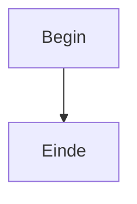

# Documentdefinities

De JSON-bestanden in deze folder specificeren hoe de verschillende outputbestanden van de Kwaliteitsaanpak gegenereerd worden.

De documentdefinitie ziet er ongeveer zo uit:

```json
{
    "BuildPath": "build/Templates/Kwaliteitsplan/",
    "DocumentFolder": "Kwaliteitsplan",
    "OutputFormats": {
        "docx": {
            "InputFile": "DocumentDefinitions/Templates/ICTU-Template-Kwaliteitsplan.md",
            "OutputFile": "ICTU-Template-Kwaliteitsplan.docx",
            "OutputPaths": [
                "docs/$VERSIE$"
            ],
            "ReferenceFile": "DocumentDefinitions/Shared/reference-ictu.docx"
        }
    },
    "VariablesFiles": [
        "DocumentDefinitions/Shared/variables.json"
    ]
}
```

Bovenstaande specificatie geeft:
- `BuildPath`: de folder waar tussenbestanden geschreven kunnen worden.
- `DocumentFolder`: de folder onder `Content/Templates` waar de inhoud van het document staat. Dit hoeft dus alleen voor templates te worden aangegeven.
- `OutputFormats`: een opsomming van de outputformaten die gegenereerd moeten worden. Mogelijke formaten zijn naast `docx`: `xlsx`, `pptx`, `html`, `json` en `zip`.
- `VariableFiles`: een lijst van bestanden met variabelen die gebruikt zijn in de Markdown bronbestanden.

Voor elk outputformaat moet worden opgegeven:
- `InputFile`: het te converteren Markdowndocument. Het document begint met de voorpagina, zie [Voorpagina](#voorpagina). Kan weggelaten worden als het outputformaat `zip` is.
- `InputPaths`: alleen bij outputformaat `zip`, de te zippen bronbestanden.
- `OutputFile`: het te schrijven bestand in het outputformaat.
- `OutputPath`: de folders waar de outputbestanden terecht komen.
- `ReferenceFile`: het (lege) bestand dat als basis gebruikt wordt voor het outputbestand. Dit is alleen nodig bij outputformaten `docx` en `pptx`.
- `StyleSheets`: de paden van te gebruiken CSS-bestanden. Bijvoorbeeld: `StyleSheets": ["basis.css", "styles/extra.css"]`. Dit is alleen bedoeld voor het outputformaat `html`. De CSS-bestanden worden als link in de HTML opgenomen, bijvoorbeeld: `<link rel="stylesheet" href="basis.css"><link rel="stylesheet" href="styles/extra.css">`. Merk op dat de paden relatief zijn ten opzichte van de locatie van het HTML-bestand. `StyleSheets` zorgt alleen voor het opnemen van de links; het kopiëren van de CSS-bestanden doe je met `CopyFiles`, zie hieronder. Naast de standaardopmaak in `DocumentDefinitions/Shared/document.css` is er een optioneel, aanvullend CSS-bestand `DocumentDefinitions/Shared/navigation.css` dat de inhoudsopgave op brede schermen toont als navigatiemenu aan de linkerkant van het scherm dat zichtbaar blijft tijdens het scrollen. Neem dit bestand op na `document.css`, zodat het de opmaak van de inhoudsopgave overschrijft.

Bij outputformaat `html` is het nodig bestanden te kopiëren naar de outputfolder. Denk aan CSS-bestanden en plaatjes. Dit kan met `CopyFiles` gespecificeerd worden:

```json
{
    "BuildPath": "build/Kwaliteitsaanpak/",
    "OutputFormats": {
        "html": {
            "InputFile": "DocumentDefinitions/Kwaliteitsaanpak/ICTU-Kwaliteitsaanpak-samenvatting.md",
            "OutputFile": "ICTU-Kwaliteitsaanpak-Samenvatting.html",
            "OutputPaths": [
                "docs/$VERSIE$"
            ],
            "StyleSheets": [
                "basis.css",
                "styles/extra.css"
            ],
            "CopyFiles": [
                {
                    "from": "DocumentDefinitions/Shared/document.css",
                    "to": "docs/$VERSIE$/basis.css"
                },
                {
                    "from": "DocumentDefinitions/Shared/fancy.css",
                    "to": "docs/$VERSIE$/styles/extra.css"
                },
                {
                    "from": "Content/Images/*.png",
                    "to": "docs/$VERSIE$"
                }
            ]
        }
    },
    "VariablesFiles": [
        "DocumentDefinitions/Shared/variables.json"
    ]
}
```

`CopyFiles` is een lijst met te kopiëren bestanden. Elk object in de lijst heeft een `from` en `to`:
- `from`: het bronbestand of de bronbestanden (`*` en `?` toegestaan).
- `to`: het doelbestand of de doelfolder. Als de `from` meerdere bestanden specificeert moet de `to` een folder zijn.

# Markdown-dialect

De bronbestanden zijn in Markdown geschreven. Naast de gebruikelijke Markdown-opmaak, zoals koppen, **vet**, _cursief_, `code`, ~~doorgehaald~~, links, plaatjes, lijsten en tabellen, kent de conversie een aantal uitbreidingen.

## Bestanden invoegen

Met `#include` wordt een ander Markdown-bestand ingevoegd. `{{DOCUMENT-FOLDER}}` wordt vervangen door de `DocumentFolder` uit de documentdefinitie:

```markdown
#include "Content/Templates/{{DOCUMENT-FOLDER}}/Template-Inhoud.md"
```

## Variabelen

`$NAAM$` wordt vervangen door de waarde van de variabele `NAAM` uit de `VariablesFiles` van de documentdefinitie, bijvoorbeeld `$KWALITEITSAANPAK$`. Variabelen worden overal vervangen, behalve in codeblokken.

## Instructies

Tekst tussen accolades, zoals `{het project}`, is een instructie voor de gebruiker van een template. Instructies worden in Word-documenten geel gearceerd.

## Blokken

Met `<!-- begin: naam -->` en `<!-- end: naam -->` wordt een blok gemarkeerd, optioneel met één attribuut. In gebruik zijn `measure` voor maatregelen (`<!-- begin: measure composite=true -->` voor maatregelen met submaatregelen), `slide` voor de inhoud van dia's in de presentatie en `landscape` voor pagina's die in Word-documenten liggend moeten worden opgemaakt, bijvoorbeeld vanwege brede tabellen. Een `landscape`-blok begint en eindigt altijd op een nieuwe pagina en mag, in tegenstelling tot andere blokken, koppen bevatten.

Binnen een maatregel markeren `[measure-title]…[/measure-title]` en `[submeasure-title]…[/submeasure-title]` de titel van de maatregel en de submaatregelen. Met `<!-- submeasures: 1,2 -->` wordt de paragraaf waarin dit staat gemarkeerd als toelichting op de submaatregelen met de genoemde nummers. In de self-assessment checklist komt die toelichting dan bij die submaatregelen te staan in plaats van bij de maatregel.

## Voorpagina

Het blok `frontpage` bevat de voorpagina van het document. Binnen het blok is de kop van niveau 1 de titel en de kop van niveau 2 de subtitel. Andere koppen zijn niet toegestaan op de voorpagina. De titel is verplicht. Koppen op de voorpagina tellen niet mee voor de nummering van de hoofdstukken. De titel is ook de titel van het document, bijvoorbeeld in de titelbalk van de browser. De koptekst van de pagina's bestaat uit de titel, gevolgd door de subtitel als die een instructie is, zoals `{het project}` bij templates. Na de voorpagina volgt automatisch een paginascheiding en de inhoudsopgave. Word-documenten en HTML-pagina's krijgen altijd een inhoudsopgave, de andere outputformaten nooit:

```markdown
<!-- begin: frontpage -->
#include "DocumentDefinitions/Shared/voorpagina-logo.md"

# ICTU Kwaliteitsaanpak Softwareontwikkeling

## Samenvatting

Versie $VERSIE$, $DATUM$

#include "DocumentDefinitions/Shared/voorpagina-woordwolk.md"
<!-- end: frontpage -->
```

Het ICTU-logo en de woordwolk staan in `DocumentDefinitions/Shared/voorpagina-logo.md` en `DocumentDefinitions/Shared/voorpagina-woordwolk.md`, zodat ze op alle voorpagina's hetzelfde zijn. Laat deze includes weg voor een neutrale voorpagina.

In Word krijgt de subtitel de stijl `Front Page Subtitle` en krijgen plaatjes onder de titel, zoals de woordwolk, de stijl `Front Page Image`. Deze stijlen staan in de referentiedocumenten (`DocumentDefinitions/Shared/reference-*.docx`) en zorgen voor de witruimte op de voorpagina.

Elk document moet een `frontpage`-blok hebben. Zonder voorpagina geeft de conversie een foutmelding.

## Bijlagen

De kop `# Bijlagen` markeert het begin van de bijlagen. Koppen in de bijlagen krijgen in Word een eigen stijl. De presentatie, de self-assessment checklist en de JSON-export slaan de bijlagen over.

## Afkortingen

Een tabel waarvan de eerste kolomkop `Afkorting` is, is de tabel met afkortingen. In de Kwaliteitsaanpak en de templates staat deze tabel in de bijlage "Terminologie en afkortingen" (`Content/Bijlagen/Terminologie.md`). De eerste kolom bevat de afkorting, de tweede kolom de betekenis. Verdere kolommen, zoals een toelichting, zijn vrij:

```markdown
| Afkorting | Betekenis | Toelichting |
|:----------|:----------|:------------|
| **IPO** | intern projectoverleg | |
| **MTP** | mastertestplan | $MTP$ |
```

Bij de conversie worden alle afkortingen uit deze tabel automatisch overal in het document gemarkeerd; in de Markdown-bronbestanden is geen extra opmaak nodig. Daarbij geldt:

- Afkortingen zijn hoofdlettergevoelig en worden alleen als heel woord herkend: `API` wel in "de API" en "API-server", maar niet in "APIs" of "api". Een afkorting aan het eind van een samenstelling, zoals `ISO` in "NEN-ISO", wordt niet gemarkeerd.
- Afkortingen in koppen, code, codeblokken, linkteksten en (sub)maatregeltitels worden niet gemarkeerd.
- Opmaak in de betekenis, zoals `**vet**`, wordt verwijderd. Variabelen in de betekenis worden vervangen.
- Een afkorting die niet in de tabel staat, wordt niet gemarkeerd en levert ook geen waarschuwing op.

In HTML wordt een afkorting een `<abbr>`-element met de betekenis als `title`, zodat de betekenis verschijnt als de lezer de muis op de afkorting houdt. De afkorting linkt naar de afkorting in de tabel, bijvoorbeeld `<a class="afkorting" href="#afkorting-ipo"><abbr title="intern projectoverleg">IPO</abbr></a>`. De afkortingen in de eerste kolom van de tabel zelf krijgen het id waar naartoe gelinkt wordt (`<abbr id="afkorting-ipo">IPO</abbr>`), maar geen `title`, omdat de betekenis er direct naast staat. Zie `DocumentDefinitions/Shared/document.css` voor de opmaak. In de andere outputformaten, zoals Word, zijn afkortingen gewone tekst.

Documenten zonder tabel met afkortingen, zoals de samenvatting en de toolgidsen, krijgen geen gemarkeerde afkortingen.

## Lijsten

Het niveau van een opsomming wordt bepaald door het opsommingsteken: `*` voor het eerste niveau, `+` voor het tweede en `-` voor het derde. Bij genummerde lijsten is `1.` het eerste niveau, `a.` het tweede en een ingesprongen `1.` het derde.

```markdown
1. eerste item
2. tweede item
a. subniveau aangegeven door een letter
 1. subsubniveau aangegeven door een ingesprongen cijfer
3. derde item


1. cijfers
1. worden
99. genegeerd
zz. het subniveau vereist een letter
 99. het subsubniveau vereist een cijfer voorafgegaan door een spatie
```

## Codeblokken

Een codeblok moet een taal hebben, zodat de code van syntax highlighting kan worden voorzien:

````markdown
```python
print("Hello world")
```
````

## Plaatjes

Een plaatje moet een titel hebben:

```markdown

```

De alternatieve tekst mag leeg zijn, bijvoorbeeld ``. In HTML bestaat de alternatieve tekst uit de titel, gevolgd door de alternatieve tekst als die er is.

Een plaatje is standaard 15 cm breed. Een andere breedte in centimeters kan met een HTML-commentaar direct achter het plaatje worden opgegeven:

```markdown
<!-- width: 5 -->
```

De breedte wordt gebruikt in Word-documenten. GitHub toont het commentaar niet en negeert de breedte dus.

## Diagrammen

Een diagram wordt als tekst vastgelegd in een codeblok met taal `mermaid`, in de syntax van [Mermaid](https://mermaid.js.org). Tijdens het genereren van de documenten wordt het diagram met [Pele](https://pele.run) omgezet naar een plaatje: SVG voor HTML (en daarmee ook PDF) en PNG voor DOCX en PPTX. Geef het diagram met `accTitle` een titel en met `accDescr` een beschrijving voor lezers die het plaatje niet kunnen zien:

````markdown

````

Gerenderde diagrammen worden bewaard in `build/diagrams`, zodat ongewijzigde diagrammen niet opnieuw worden gerenderd. Een ongeldig diagram leidt tot een foutmelding met het diagram en de plek van de fout. GitHub toont Mermaid-diagrammen ook direct in Markdown-bestanden. Met de [playground van Pele](https://pele.run) kun je een diagram uitproberen.

## Admonitions

Admonitions (ook wel callouts of alerts) zijn gekleurde blokken die de aandacht vestigen op een opmerking, tip of waarschuwing. De syntax is die van [GitHub-alerts](https://docs.github.com/en/get-started/writing-on-github/getting-started-with-writing-and-formatting-on-github/basic-writing-and-formatting-syntax#alerts). Er zijn vijf typen, elk met een eigen kleur, icoon en standaardtitel:

```markdown
> [!NOTE]
> Informatie die de lezer moet meenemen, ook bij snel lezen. Standaardtitel: "Opmerking".

> [!TIP]
> Optionele informatie die de lezer helpt. Standaardtitel: "Tip".

> [!IMPORTANT]
> Cruciale informatie die de lezer nodig heeft. Standaardtitel: "Belangrijk".

> [!WARNING]
> Informatie die vanwege mogelijke risico's direct aandacht vraagt. Standaardtitel: "Waarschuwing".

> [!CAUTION]
> Mogelijke negatieve gevolgen van een handeling. Standaardtitel: "Let op".
```

Regels:

- Het type is niet hoofdlettergevoelig: `> [!note]` mag ook.
- Een tekst achter het type vervangt de standaardtitel, bijvoorbeeld `> [!WARNING] Aandachtspunt`. Variabelen in de titel worden vervangen. Let op: GitHub toont een admonition met eigen titel niet als alert, maar als gewoon citaat.
- De admonition loopt tot de eerste regel die niet met `>` begint. Een lege regel beëindigt de admonition dus ook. Een nieuwe `> [!TYPE]`-regel beëindigt de vorige admonition en begint een nieuwe.
- De inhoud is gewone Markdown: alinea's, (geneste) lijsten, tabellen, codeblokken, opmaak, links en variabelen werken binnen een admonition. Een regel met alleen `>` scheidt alinea's. Koppen zijn niet toegestaan in een admonition.

Bijvoorbeeld:

```markdown
> [!TIP] Meer weten?
> Lees de **toolgids** voor:
>
> * het [installeren](https://example.org/installeren) van de tool;
> * het configureren van de tool.
```

In HTML wordt een admonition een `<aside>`-element met de classes `admonition` en `admonition-<type>`, zie `DocumentDefinitions/Shared/document.css` voor de opmaak. In Word wordt een admonition een tabel met één gekleurde cel. De opmaak staat in de referentiedocumenten (`DocumentDefinitions/Shared/reference-*.docx`): een tabelstijl `Admonition <Type>` voor de linkerrand en achtergrondkleur en een tekenstijl `Admonition <Type> Title` voor de titel, bijvoorbeeld `Admonition Warning` en `Admonition Warning Title`. Pas bij het wijzigen van de kleuren zowel de CSS als beide referentiedocumenten aan. In de self-assessment checklist wordt de tekst van een admonition, voorafgegaan door de titel, opgenomen in de toelichting bij de maatregel. De presentatie neemt alleen de tekst over.
